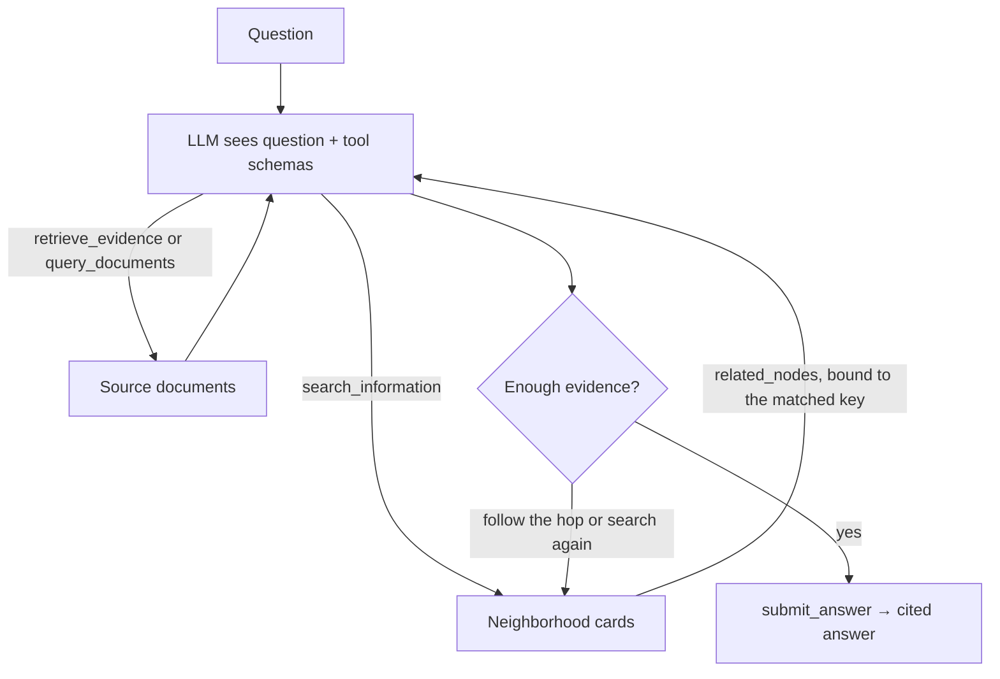

# Mongo Adaptive Retrieval Engine (MARE)

[](LICENSE)

MARE indexes a MongoDB workload you already have. Point it at your collections. It profiles the fields, groups documents into neighborhoods, and keeps a hop only when a string field actually matches another collection's `_id`. A question then runs the tool loop: search a neighborhood, read the documents, follow that hop, filter or count.

RAG embeds every chunk and answers from Top-K. MARE embeds one card per neighborhood and cites `database.collection:document_id`.

The packaged demo is a SaaS-ops corpus (`mare_demo`) used for the RAG comparison below. With `MARE_GENERIC_INDEX` left off, `POST /ask` runs that demo. Your database is indexed with [the commands below](#use-it-on-your-mongodb), and the saved cards can be queried from a later script, from `POST /ask`, or from MCP. You do not edit collection names, `customer_id`, or the demo hop code.

This slice indexes the documents you load. It records traces. It does not rebuild the index from later questions.

**Contents:** [Your MongoDB](#use-it-on-your-mongodb) · [When to use](#when-to-use-mare) · [Demo](#packaged-demo) · [Results](#results) · [How a question is answered](#how-a-question-is-answered)

## Use it on your MongoDB

Python 3.12+. `MONGODB_URI` and `OPENAI_API_KEY` in `.env` (`OPENAI_MODEL=gpt-5`, `OPENAI_MODEL_AGENT=gpt-5-mini`).

```bash
python3 -m venv .venv && source .venv/bin/activate
pip install -e ".[dev]"
cp .env.example .env
```

Index the database once. The command reads each collection, writes neighborhood cards and hops into `_agent_retrieval`, and leaves your documents where they are. A later process on the same cluster loads those cards and reads the live collections.

```bash
python scripts/index_generic.py --database your_db
python scripts/ask_generic.py "Which order was refunded because a sweater pilled after one wash?"
```

`--limit 1000` indexes the first 1,000 documents of each collection. Counts then cover that saved set. Omit `--limit` to index every document. `--collection orders` repeats for each collection you want to include.

Set `MARE_GENERIC_INDEX=true` and the same saved index answers `POST /ask` and the MCP `ask` tool. Leave the flag off and those endpoints stay on the SaaS demo. `scripts/bootstrap.py` seeds `mare_demo` only.

What the index uses:

1. Field types come from up to 1,000 documents per collection (`MARE_GENERIC_SAMPLE_SIZE`). The model that proposes schema sees names and types, not values.
2. Text fields are chosen from `reason`, `description`, `title`, `note`, `text`, `summary`, `comment`, and `name`.
3. A hop is kept when at least 80% of a string field's values equal `_id` in another collection. ObjectId values are matched as the same string. The agent then opens that document.
4. The tool loop is schema-blind: `search_information`, `retrieve_evidence`, `query_documents`, `submit_answer`. No `tenant_id` is injected.

## When to use MARE

| Question | Use |
| --- | --- |
| The id is already in the question | RAG or `find` |
| The answer lives on another document, joined by an id the question never names | **MARE** |
| The cause is split across collections | **MARE** |
| You need a count or a proof that nothing matched, inside the documents you loaded | **MARE** or `find` |
| You want the nearest chunks | RAG |

On a 74-document workload built so the answer is not on the nearest chunk, the schema-blind loop (`gpt-5-mini` tools, `gpt-5` answers) beat hybrid RAG at the product default K=8. Bridge: the carrier lane existed only on the order. Distributed: the assay finding existed only on the assay. RAG K=1 and K=8 both missed them (gold recall 0.00). MARE retrieved the hidden document both times (recall 1.00). Absence was a tie: both answered 0. Mean MARE was 5 turns, 8.3k tokens, 21 s. RAG was one Top-K call, about 0.6k–0.8k tokens and 7 s. Write-up: [reports/generic_utility.md](reports/generic_utility.md).

## Packaged demo

The demo is the SaaS corpus the RAG numbers below were measured on. Atlas 8.0.

```bash
python scripts/bootstrap.py
uvicorn app.main:app --reload --port 8080
curl -s localhost:8080/ask -H 'Content-Type: application/json' \
  -d '{"question":"How many customers are on the enterprise subscription tier?"}'
```

`POST /ask/rag` is the same question through conventional RAG. Leave `MARE_SCHEMA_IN_PROMPT=false`. No API key means the heuristic reasoner, which is for tests.

| Endpoint | Purpose |
| --- | --- |
| `POST /ask` | Demo agent loop, grounded citations |
| `POST /ask/rag` | Top-K RAG on the demo corpus |
| `GET /sessions/{id}` / `.../traces` | Answer and every tool step |
| `GET /navigation/...` | Browse the demo hierarchy |
| `GET /metrics/vectors` | Demo MARE vs RAG vector counts |

MCP for the demo: `python -m app.mcp_server.server`. Tools: `ask`, `search_information`, `retrieve_evidence`, `query_documents`, `read_documents`. Tenant scope is injected on that path.

```bash
python scripts/run_comparison.py              # demo cases
python scripts/run_comparison.py --informed   # schema-in-prompt control
python scripts/run_comparison.py --mongo-mcp  # find/count MCP control
python scripts/run_generic_agent.py --utility # abstract index vs RAG, bridge / distributed / absence
python scripts/run_generic_agent.py           # same loop on the shop and warehouse fixtures
python scripts/index_generic.py --database your_db
python scripts/ask_generic.py "your question"
```

## Results

### Abstract index (74 documents)

Same tool loop as the demo, on a workload with no SaaS fields. Hybrid RAG, one chunk per document. K=8 is the product default and is not the whole database.

| Case | MARE | Recall | RAG K=1 | RAG K=8 |
| --- | --- | ---: | --- | --- |
| Bridge (carrier only on the order) | yes | 1.00 | no | no |
| Distributed (finding only on the assay) | yes | 1.00 | no | no |
| Absence (`sku_plain` in April) | yes | n/a | yes | yes |

[reports/generic_utility.md](reports/generic_utility.md).

Shop (5 documents) and warehouse (7 documents), same tool loop. K=8 is the whole corpus, and the linking document already stores the foreign key, so both sides answer 8/8. One-shot `investigate`: [reports/generic_mare.md](reports/generic_mare.md). Tool loop: [reports/generic_agent.md](reports/generic_agent.md).

| case | MARE | recall | ms | tok | turns | tools | RAG K=1 | recall | ms | tok | RAG K=8 | recall | ms | tok |
| --- | ---: | ---: | ---: | ---: | ---: | ---: | ---: | ---: | ---: | ---: | ---: | ---: | ---: | ---: |
| Shop lookup | yes | 1.00 | 9794 | 4032 | 4 | 3 | yes | 1.00 | 6006 | 311 | yes | 1.00 | 3671 | 454 |
| Shop hop | yes | 0.00 | 10166 | 4199 | 4 | 3 | yes | 0.00 | 4652 | 306 | yes | 1.00 | 5076 | 584 |
| Shop count | yes | 1.00 | 12102 | 4289 | 4 | 3 | yes | 1.00 | 6004 | 491 | yes | 1.00 | 4178 | 513 |
| Shop absence | yes | n/a | 16496 | 6143 | 5 | 4 | yes | n/a | 12371 | 897 | yes | n/a | 11340 | 1089 |
| Warehouse lookup | yes | 1.00 | 10668 | 4331 | 4 | 3 | yes | 1.00 | 5335 | 345 | yes | 1.00 | 6836 | 789 |
| Warehouse count | yes | 1.00 | 10599 | 4684 | 4 | 3 | yes | 1.00 | 4280 | 359 | yes | 1.00 | 3996 | 592 |
| Warehouse absence | yes | n/a | 15007 | 6488 | 5 | 4 | yes | n/a | 5752 | 557 | yes | n/a | 7641 | 1020 |
| Warehouse hop | yes | 1.00 | 10747 | 4617 | 4 | 3 | yes | 0.00 | 4871 | 405 | yes | 1.00 | 4038 | 592 |
| mean | **8/8** |  | **11947** | **4848** | **4** | **3** | **8/8** |  | **6159** | **459** | **8/8** |  | **5847** | **704** |

### Demo vs hybrid RAG (K=10)

Nine cases on `mare_demo`. Vectors **616 vs 5,424** (11%).

| Case | MARE | RAG | What it tests |
| --- | --- | --- | --- |
| Named lookup / named multi-hop | yes | yes | IDs in the question. |
| **Bridge** (entity not named) | **yes** | **no** | Hop via `related_nodes`. |
| Aggregation (count enterprise) | no* | 8 (Top-K) | *Retrieved all 18; synthesizer did not count. |
| **Negative** (Cedar in April) | **yes** | **no** | Prove absence. |
| **Distributed** (Northstar) | **yes** | **no** at K=10; yes at K=20 | Lookalike customer at default K. |
| Variable-K Apex (small / medium / deep) | no / yes / yes | no† / yes / yes | †RAG K=5 complete on small; K=10 omitted the entity. |

Full prompts and traces: [reports/README.md](reports/README.md).

### Demo vs Mongo MCP

Same nine questions, schema-blind `list` / `schema` / `find` / `count`, no navigation index.

| | MARE | MCP | RAG |
| --- | ---: | ---: | ---: |
| Answer correct | **7/9** | 3/9 | 4/9 |

MCP matches named lookup and absence. It misses the bridge and the distributed / variable-K hops. [reports/mongo_mcp.md](reports/mongo_mcp.md).

### Scale (10K incidents, LLM-on)

Agent plus a small navigation index plus Mongo tools. Semantic nav is **604 vectors vs 60,000 RAG chunks**. Blind agent vs hybrid Top-K RAG. 20 held-out questions, 4 per category. The embedding footprint is about 1% of RAG; the loop spends more tokens and a little more latency to get there.

| | MARE | RAG |
| --- | ---: | ---: |
| Persistent vectors | **604 (1%)** | 60,000 |
| Answer correct | **19/20** | 18/20 |
| Gold-id recall | 0.32 | 0.28 |
| Latency | 37 s | 12 s |
| Tokens | **15.7k** | 2.1k |
| Tool calls | 4.5 | 0 |

Receipts are on by default (`MARE_COMPACT=true`). Full-history vanilla was 40.6k tokens / 25 s. [ACGC](https://github.com/shekhartata/acgcProject) stays off (`MARE_ACGC=false`); the sidecar on top of receipts did not cut tokens (19.7k). Ablation: [reports/scale/llm_on_acgc_ablation.md](reports/scale/llm_on_acgc_ablation.md). Retrieval-only scoring of the navigation index: [reports/scale/README.md](reports/scale/README.md).

## How a question is answered

```text
Question → schema-blind tool loop
              ├── Navigation  (where?)  →  one card per neighborhood
              └── Retrieval   (what?)   →  the documents you loaded, or live demo Mongo
                         ↓
              answer + database.collection:document_id
```

On your database the cards are the saved generic index in `_agent_retrieval`: lexical overlap, plus an OpenAI embedding of each card when `OPENAI_API_KEY` is set. A related node carries the foreign key from the document that matched, so the next retrieve opens that live document. `query_documents` accepts equality and range filters on fields the index has seen. `$where` is rejected.

On the demo, the same loop searches Atlas `navigation_nodes` (`nav_lexical` plus one `voyage-4-lite` vector per card) and then `find`s `mare_demo`. Ten thousand incidents become about 604 vectors against about 60,000 chunks. `scripts/probe_capabilities.py` records whether autoEmbed is active.



The loop stops at `submit_answer` or the turn budget (default 10).

```bash
pytest -q
```

```text
app/indexing/signals/   generic index: profile, validate, plans
app/indexing/           demo hierarchy and semantic grouping
app/retrieval/          agent loop and generic tool handlers
app/search/             demo lexical / vector / hybrid tools
app/baseline/           RAG, including the in-memory hybrid used above
app/eval/               answer scoring
```

## License

[Apache License 2.0](LICENSE).
